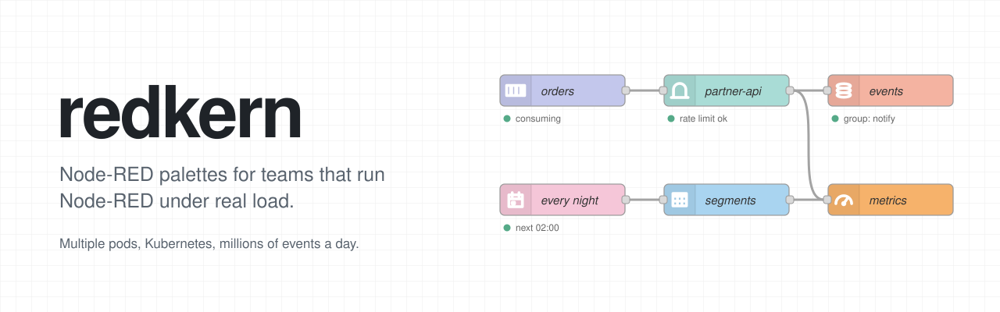
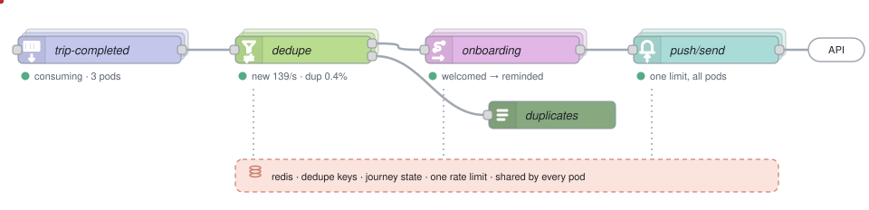

<p align="center">
  <picture>
    <source media="(prefers-color-scheme: dark)" srcset="./assets/banner-dark.svg">
    
  </picture>
</p>

<p align="center">
  
  
  
  
</p>

<p align="center"><b>Node-RED is great until the second pod.</b></p>

Then the `delay` node limits each pod on its own, an `inject` fires once per replica, a redeploy drops in-flight
messages and a retry lives in memory until the next restart. **redkern** is a set of palettes built for that moment:
state lives where every pod can see it, rollouts are safe, and every node tells you what it is doing.

<p align="center">
  <picture>
    <source media="(prefers-color-scheme: dark)" srcset="./assets/flow-dark.svg">
    
  </picture>
</p>

## Core Node-RED vs redkern, on three pods

| What happens | Core Node-RED | redkern |
| --- | --- | --- |
| `delay` set to 10 msg/s | 30 msg/s, and it changes with every HPA step | 10 msg/s for the whole cluster · **flow-control** |
| Kafka redelivers a message | processed twice | claim and commit drops the duplicate · **flow-control** |
| `inject` at 09:00 | fires three times | fires once, in the schedule's own timezone · **scheduler** |
| "Send a push in 2 hours" | lost on restart | kept in Redis, claimed by one pod · **jobs** |
| A rider moves through onboarding | step state in context, one per pod | one state per rider, atomic transitions · **journey** |
| Redeploy in the middle of a stream | in-flight messages dropped | drained and acknowledged · **redis**, **kafka** |
| Calls to a partner API | each pod has its own limit | one limit and one queue for all pods · **gateway** |

## Palettes

Each palette works on its own. Install only what you need:

```bash
npm install @redkern/node-red-gateway
```

#### Move data

| | Package | What it does | Status |
| :---: | --- | --- | --- |
|  | [`@redkern/node-red-gateway`](https://github.com/redkern/node-red-gateway) | Gateway between Node-RED instances over WebSocket: distributed rate limiting (GCRA), Redis Streams queue, idempotency, deadlines and retries | [](https://www.npmjs.com/package/@redkern/node-red-gateway) |
|  | [`@redkern/node-red-kafka`](https://github.com/redkern/node-red-kafka) | Kafka on librdkafka: consumer groups with manual ack, Protobuf and Avro via Schema Registry, SCRAM |  |
|  | [`@redkern/node-red-redis`](https://github.com/redkern/node-red-redis) | Redis commands, Pub/Sub and Streams with consumer groups, PEL recovery, DLQ, backpressure and drain for rollouts |  |
|  | [`@redkern/node-red-snowflake`](https://github.com/redkern/node-red-snowflake) | Snowflake queries with key-pair auth, a managed connection pool, timeouts, cancellation and row limits |  |

#### Control and orchestrate

| | Package | What it does | Status |
| :---: | --- | --- | --- |
|  | [`@redkern/node-red-scheduler`](https://github.com/redkern/node-red-scheduler) | Schedules built in the editor instead of cron: a timezone per schedule, a preview of the next runs, overlap protection and optional run-once across pods |  |
|  | [`@redkern/node-red-flow-control`](https://github.com/redkern/node-red-flow-control) | Flow control shared by all pods through Redis: idempotency with claim and commit, rate limits and per-key frequency caps, semaphores, retries with backoff and DLQ, message rate meters |  |
|  | [`@redkern/node-red-jobs`](https://github.com/redkern/node-red-jobs) | Delayed jobs that survive restarts: schedule by job ID, cancel by tag, workers that claim jobs atomically across pods, ack and nack with retry and DLQ |  |
|  | [`@redkern/node-red-journey`](https://github.com/redkern/node-red-journey) | Persistent state machines for multi-step journeys: definitions versioned in Git, per-entity state in Redis, timers, atomic transitions across pods |  |

#### Observe and ship

| | Package | What it does | Status |
| :---: | --- | --- | --- |
|  | [`@redkern/node-red-prometheus`](https://github.com/redkern/node-red-prometheus) | Contract-based Prometheus metrics with cardinality limits; one `/metrics` for all redkern palettes |  |
|  | [`@redkern/node-red-flow-splitter`](https://github.com/redkern/node-red-flow-splitter) | Editor plugin that splits `flows.json` into per-tab files with stable names for Git review and audit trails |  |

#### Foundation

| | Package | What it does | Status |
| :---: | --- | --- | --- |
|  | [`@redkern/node-red-kit`](https://github.com/redkern/node-red-kit) | Zero-dependency runtime library shared by all redkern packages: config, secrets, auth, lifecycle, resilience, Redis client factory, metrics | [](https://www.npmjs.com/package/@redkern/node-red-kit) |

<sub>**npm** published and stable · **in development** pre-releases on GitHub Releases · **planned** designed, not started</sub>

## Principles

<table>
<tr>
<td width="50%" valign="top">

**Honest delivery guarantees**<br>
No silent message loss on redeploy, pause or rollout. Where at-least-once means a message can arrive twice, the docs say so.

</td>
<td width="50%" valign="top">

**Multi-pod aware**<br>
Consumer identity, limits, locks, backpressure, drain and cleanup work with HPA and rolling deploys.

</td>
</tr>
<tr>
<td valign="top">

**Secure by default**<br>
Secrets live in credentials, admin APIs sit behind Node-RED permissions, and no listener accepts unauthenticated traffic beyond loopback.

</td>
<td valign="top">

**Independent palettes**<br>
Packages share only `@redkern/node-red-kit`, which has no runtime dependencies. No palette depends on another palette.

</td>
</tr>
<tr>
<td valign="top">

**Safe to migrate**<br>
Data names such as Redis keys, Kafka group IDs and metric names never change, so dashboards and offsets survive the switch.

</td>
<td valign="top">

**One look in the editor**<br>
Each palette has its own color and icon motif, and every node shows its live state in the status line.

</td>
</tr>
</table>

## Releases

Stable versions from 1.0.0 are published to npm from GitHub Actions with provenance. Pre-releases are available as tarballs on GitHub Releases. Every package follows semver and keeps a changelog.

## Contact

- **Bugs and questions:** open an issue in the package repository
- **Security:** see our [security policy](https://github.com/redkern/.github/blob/main/SECURITY.md)
- **Everything else:** support@redkern.com

---

<p align="center"><sub>Apache-2.0 licensed · Made in Kyiv</sub></p>
