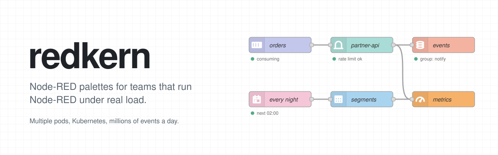

<p align="center">
  <picture>
    <source media="(prefers-color-scheme: dark)" srcset="./assets/banner-dark.svg">
    
  </picture>
</p>

<p align="center">
  
  
  
</p>

Production-grade Node-RED palettes and plugins for teams that run Node-RED under real load:
millions of events per day, multiple pods, Kubernetes, and on-call.

Each palette works on its own. Install only what you need:

```bash
npm install @redkern/node-red-gateway
```

## Palettes

| | Package | What it does | Status |
| :---: | --- | --- | --- |
|  | [`@redkern/node-red-gateway`](https://github.com/redkern/node-red-gateway) | Gateway between Node-RED instances over WebSocket: distributed rate limiting (GCRA), Redis Streams queue, idempotency, deadlines and retries | [](https://www.npmjs.com/package/@redkern/node-red-gateway) |
|  | [`@redkern/node-red-prometheus`](https://github.com/redkern/node-red-prometheus) | Contract-based Prometheus metrics with cardinality limits; one `/metrics` for all redkern palettes |  |
|  | [`@redkern/node-red-snowflake`](https://github.com/redkern/node-red-snowflake) | Snowflake queries with key-pair auth, a managed connection pool, timeouts, cancellation and row limits |  |
|  | [`@redkern/node-red-redis`](https://github.com/redkern/node-red-redis) | Redis commands, Pub/Sub and Streams with consumer groups, PEL recovery, DLQ, backpressure and drain for rollouts |  |
|  | [`@redkern/node-red-kafka`](https://github.com/redkern/node-red-kafka) | Kafka on librdkafka: consumer groups with manual ack, Protobuf and Avro via Schema Registry, SCRAM |  |
|  | [`@redkern/node-red-scheduler`](https://github.com/redkern/node-red-scheduler) | Schedules built in the editor instead of cron: a timezone per schedule, a preview of the next runs, overlap protection and optional run-once across pods |  |

## Plugins

| | Package | What it does | Status |
| :---: | --- | --- | --- |
|  | [`@redkern/node-red-flow-splitter`](https://github.com/redkern/node-red-flow-splitter) | Splits `flows.json` into per-tab files with stable names for Git review and audit trails |  |
|  | [`@redkern/node-red-migrate`](https://github.com/redkern/node-red-migrate) | Editor plugin that migrates flows from legacy `@yroshcha/*` packages tab by tab, keeping settings, secrets and consumer identity |  |

## Library

| | Package | What it does | Status |
| :---: | --- | --- | --- |
|  | [`@redkern/node-red-kit`](https://github.com/redkern/node-red-kit) | Zero-dependency runtime library shared by all redkern packages: config, secrets, auth, lifecycle, resilience, Redis client factory, metrics | [](https://www.npmjs.com/package/@redkern/node-red-kit) |

## Principles

**Honest delivery guarantees.** No silent message loss on redeploy, pause or rollout. Where at-least-once means a message can arrive twice, the docs say so.

**Multi-pod aware.** Consumer identity, backpressure, drain and cleanup work with HPA and rolling deploys.

**Secure by default.** Secrets live in credentials, admin APIs sit behind Node-RED permissions, and no listener accepts unauthenticated traffic beyond loopback.

**Independent palettes.** Packages share only `@redkern/node-red-kit`, which has no runtime dependencies. No palette depends on another palette.

**Safe to migrate.** Data names such as Redis keys, Kafka group IDs and metric names never change, so dashboards and offsets survive the switch.

## Releases

Stable versions from 1.0.0 are published to npm from GitHub Actions with provenance. Pre-releases are available as tarballs on GitHub Releases. Every package follows semver and keeps a changelog.

## Contact

- Bugs and questions: open an issue in the package repository
- Security: see our [security policy](https://github.com/redkern/.github/blob/main/SECURITY.md)
- Everything else: support@redkern.com

---

<sub>Apache-2.0 licensed. Made in Kyiv.</sub>